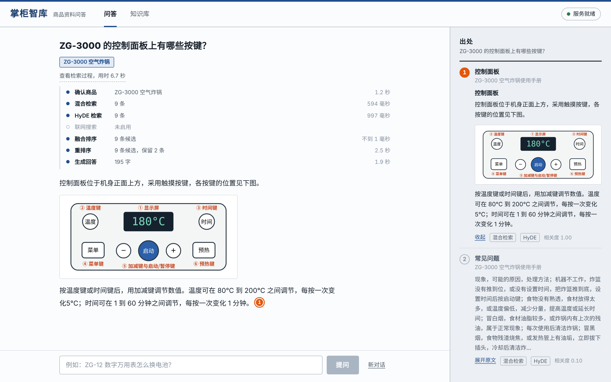
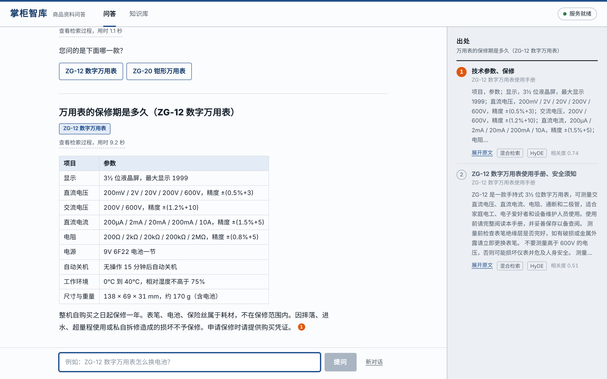
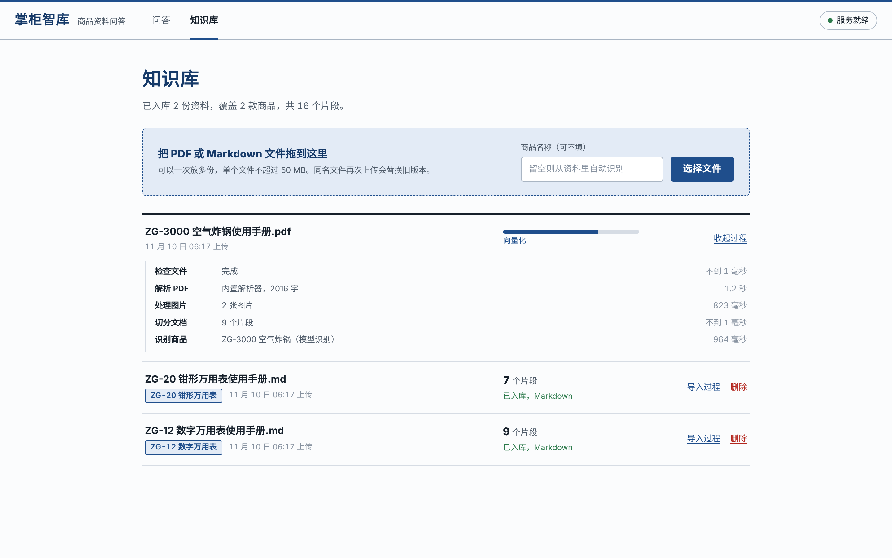
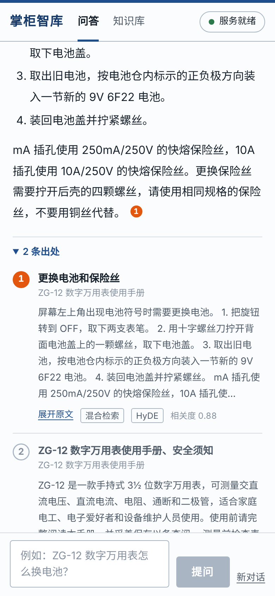
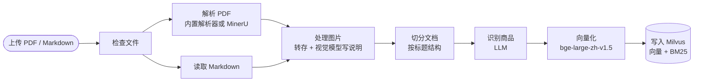
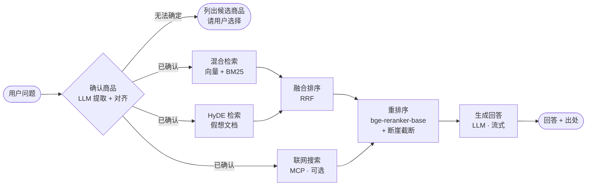
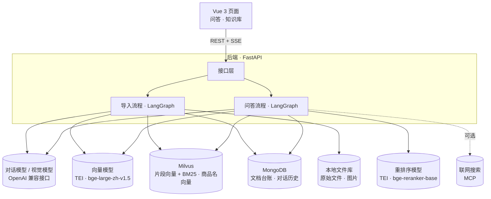

# 掌柜智库 · 商品资料问答知识库（RAG）

把商品的说明书、规格表、售后政策交给它，然后直接提问。

掌柜智库先确认你问的是**哪一款商品**，再从这款商品的资料里**混合检索 → 融合 → 重排序**，挑出真正相关的几段交给大模型作答。回答里的说法标着出处编号，点一下就能看到原文；资料里的图片会跟着回答一起出现。



| 商品有歧义时先确认，不猜 | 资料导入的每一步都看得见 |
|---|---|
|  |  |



## 特性

- **先确认商品，再检索**：同一个知识库里往往有几十款相似的商品，「怎么换电池」不说清楚是哪一款，检索回来的就是一锅粥。智库先把用户的叫法（「ZG12」「那个钳形表」）对齐到知识库里的标准商品名，检索只在这款商品的资料范围内进行。对不上或有歧义时列出候选让用户点选，不替用户猜。
- **型号差一位也不放过**：`ZG-12` 和 `ZG-13` 的名称向量相似度高达 0.9，单看相似度会把不存在的型号「纠正」成库里有的那一款。对齐时会单独比对型号，型号不一致就不自动确认。
- **三路检索**：语义向量 + BM25 关键词的混合检索、HyDE（先让模型写一段假想的手册原文再去检索）、可选的联网搜索，三路并行。
- **重排序与断崖截断**：候选资料由交叉编码器逐条打分。保留几条不是写死的 Top-K，而是看分数在哪里出现断崖——相关资料只有两段时就只给模型两段，少一些似是而非的干扰。
- **回答有出处**：回答里的说法标注资料编号，页面上编号与出处一一对应，可展开原文；检索到但没被引用的资料用空心编号区分。没有检索到相关资料时直接说明，不让模型硬编。
- **听得懂追问**：「它显示 E2 是什么意思」会结合对话历史补全成完整的问题，并沿用上一轮确认的商品。会话保存在 MongoDB，刷新页面后还在。
- **图片也是资料**：PDF 里的示意图会被提取出来；配置视觉模型后为每张图生成说明文字，图片内容可以被检索到，并随回答一起展示。
- **导入过程可见**：解析 → 处理图片 → 切分 → 识别商品 → 向量化 → 入库，每一步的结果和用时都记录在案。同名文件再次上传视为更新，新版本入库成功后才移除旧版本。
- **部署轻**：向量检索和 BM25 全文检索都由一个 Milvus 容器完成，不需要另外维护搜索引擎和对象存储；向量模型、重排序模型在本机 CPU 上运行，只有对话模型调用外部接口。
- **坏了也能用**：重排序模型不可用时退回融合排序；商品提取失败时退回字面匹配；联网搜索、HyDE 失败时跳过这一路。模型密钥无效、余额不足、限流、连不上，都会变成一句可操作的中文提示。
- **可验收**：自带端到端验收脚本；另有 134 个后端单元测试和 8 个前端单元测试，不依赖任何外部服务即可运行。

## 工作原理

两条流程都是 [LangGraph](https://github.com/langchain-ai/langgraph) 状态图，每个方框是一个节点，节点开始和结束时都会推送一条进度事件。

### 导入资料



| 阶段 | 做什么 | 为什么这样做 |
|---|---|---|
| 解析 PDF | 还原标题层级、列表、表格，导出图片 | 内置解析器基于 PyMuPDF，零配置；装了 [MinerU](https://github.com/opendatalab/MinerU) 会自动改用它处理多栏、公式和扫描件 |
| 解析后修正 | 把图片放回它在页面上的位置、接回被版心折断的段落、拼回跨页的表格 | PDF 提取出来的文字是按版面断开的，直接切分会把一句话、一张表切成两半 |
| 处理图片 | 图片转存到本地文件库；配置了视觉模型时，结合上下文为每张图写一句说明 | 说明文字会进入片段正文，「控制面板上有哪些按键」这样的问题才检索得到示意图 |
| 切分文档 | 先按标题拆成章节；超长的章节按段落、行、句子逐级细分，表格拆开时每段都带表头；过短的相邻小节合并 | 片段上限 480 字，与向量模型 512 token 的窗口匹配；每个片段带着自己的标题和上级标题 |
| 识别商品 | 模型根据文件名和正文开头判断这份资料讲的是哪个商品；上传时也可以直接指定 | 商品名是之后检索的过滤条件 |
| 向量化与入库 | 向量化的文本是「商品名 + 上级标题 + 正文」；片段 ID 由文档和序号决定，写入是幂等的 | 把商品名和标题拼进去，孤零零的一段「按住 2 秒」才有上下文 |

### 回答问题



| 阶段 | 做什么 |
|---|---|
| 确认商品 | 模型从问题和对话历史中提取商品叫法，并把问题改写成不依赖上下文的完整问题。叫法与知识库里的商品名对齐：先看字面（完全一致，或一个包含另一个），对不上再看名称向量的相似度；相似度达到 0.70、没有接近的对手、型号也对得上时确认，否则把相近的商品作为候选 |
| 混合检索 | 在已确认商品的资料范围内，语义向量（COSINE）和 BM25（Milvus 内置的中文分词与 BM25 函数）各取一路，由 Milvus 用 RRF 合并 |
| HyDE 检索 | 模型先写一段 150–250 字的「假想手册原文」，用「问题 + 假想原文」的向量再检索一次。问题很短而资料是成段的陈述，假想原文在措辞上更接近真正的资料；它本身不会进入回答 |
| 联网搜索 | 通过 MCP 调用外部搜索工具，默认关闭 |
| 融合排序 | 两路知识库结果按 RRF（k=60）合并去重，保留 12 条候选 |
| 重排序 | 交叉编码器对「问题—资料」逐对打分，联网结果也在这里一起打分。按分数从高到低找第一处断崖（相对落差超过 50% 或绝对落差超过 0.3），断崖之后的丢弃；最少保留 2 条，最多 6 条 |
| 生成回答 | 把保留的资料编号后交给模型，要求只依据资料作答并标注编号，逐字推送到页面 |

## 架构



**技术栈**：Python 3.12 · FastAPI · LangGraph 1.2 · LangChain Core 1.7 · Milvus 2.5 · MongoDB 7 · Text Embeddings Inference · PyMuPDF · MCP · Vue 3 · Vite

## 快速开始

### 环境要求

- Docker（含 Compose v2），可用内存建议 8 GB（两个模型加 Milvus 运行时约占 4 GB）
- [uv](https://docs.astral.sh/uv/)（会自动准备 Python 3.12）
- Node.js 20.19 或更高版本
- 一个大模型 API Key（默认[阿里云百炼](https://bailian.console.aliyun.com/)，或任意 OpenAI 兼容服务）

首次启动需要拉取三个镜像（解压后共约 4.5 GB），并下载约 2.4 GB 的向量模型和重排序模型。

### 安装并启动

Windows：

```bat
zhiku setup
:: 在 .env 中填写 LLM_API_KEY，然后：
zhiku start
```

macOS / Linux：

```bash
scripts/zhiku.sh setup
# 在 .env 中填写 LLM_API_KEY，然后：
scripts/zhiku.sh start
```

`setup` 会生成 `.env`（数据库密码为随机值）、启动依赖服务、安装前后端依赖并构建前端。`start` 之后打开 <http://127.0.0.1:18100>。

### 导入示例资料

`samples/` 下有三份示例手册（两份 Markdown、一份带示意图的 PDF）。可以在页面的「知识库」里上传，也可以另开一个终端执行：

```bash
scripts/zhiku.sh samples        # Windows：zhiku samples
```

导入完成后可以这样问：

- ZG-12 怎么更换电池？
- 钳形表怎么测量交流电流
- ZG-3000 的控制面板上有哪些按键？ → 接着问：它显示 E2 是什么意思
- 万用表的保修期是多久（库里有两款万用表，会先请你选）

### 其他命令

| 命令 | 作用 |
|---|---|
| `stop` | 停止依赖服务，数据全部保留 |
| `samples` | 导入三份示例手册（需要后端已启动） |
| `check` | 逐项检查向量库、文档库、两个模型和模型密钥 |
| `verify` | 端到端验收（需要后端已启动） |
| `test` | 运行前后端单元测试 |

### 手动执行每一步

```bash
cp .env.example .env                 # 填写 MONGO_PASSWORD 和 LLM_API_KEY
docker compose up -d --wait          # 启动 Milvus、MongoDB、向量模型、重排序模型

cd backend
uv sync --locked

cd ../frontend
npm ci && npm run build              # 构建后由后端同源托管

cd ../backend
uv run python main.py                # http://127.0.0.1:18100
```

前端开发时可以单独运行 `npm run dev`（<http://127.0.0.1:15273>），`/api` 会代理到后端。

## 配置

所有配置都在项目根目录的 `.env` 中，模板见 [.env.example](.env.example)。

| 变量 | 默认值 | 说明 |
|---|---|---|
| `MONGO_PASSWORD` | 无，必填 | MongoDB 密码，`setup` 会自动生成 |
| `LLM_API_KEY` | 无，必填 | 大模型密钥 |
| `LLM_BASE_URL` | `https://dashscope.aliyuncs.com/compatible-mode/v1` | 任意 OpenAI 兼容接口 |
| `LLM_MODEL` | `qwen-flash` | 对话模型 |
| `VISION_MODEL` | 空 | 支持图片输入的模型；填写后为资料中的图片生成说明 |
| `WEB_SEARCH_MCP_URL` | 空 | 提供搜索工具的 MCP 服务地址；填写后启用联网搜索 |
| `WEB_SEARCH_TOOL` | `bailian_web_search` | 搜索工具的名称，接受 `query`、`count` 两个参数 |
| `EMBEDDING_MODEL_ID` / `RERANK_MODEL_ID` | `BAAI/bge-large-zh-v1.5` / `BAAI/bge-reranker-base` | 设为 `/models/<目录名>` 可使用 `deploy/models/` 下的离线模型 |
| `PDF_PARSER` | `auto` | `auto`：装了 MinerU 就用它，否则用内置解析器；也可固定为 `mineru` 或 `pymupdf` |
| `APP_PORT` | `18100` | 后端与页面 |
| `MILVUS_PORT` / `MONGO_PORT` / `EMBEDDING_PORT` / `RERANK_PORT` | `19630` / `27117` / `18181` / `18182` | 依赖服务的本机端口 |

切片长度、检索条数、重排序截断阈值、商品对齐阈值等参数同样可以用环境变量覆盖，名称和默认值见 `backend/app/config.py`。

端口只绑定 `127.0.0.1`，并且避开了各服务的默认端口。

**无法访问 HuggingFace 时**：把 [bge-large-zh-v1.5](https://huggingface.co/BAAI/bge-large-zh-v1.5) 和 [bge-reranker-base](https://huggingface.co/BAAI/bge-reranker-base) 的全部文件分别下载到 `deploy/models/` 下的同名目录，并在 `.env` 中设置：

```dotenv
EMBEDDING_MODEL_ID=/models/bge-large-zh-v1.5
RERANK_MODEL_ID=/models/bge-reranker-base
```

**使用 MinerU 解析 PDF**：按 MinerU 的文档安装后，确认命令行里能执行 `mineru`，智库会自动改用它。命令不在 `PATH` 里时用 `MINERU_COMMAND` 指定。

## 接口

### 文档

| 接口 | 说明 |
|---|---|
| `POST /api/documents` | 上传资料（`multipart/form-data`：`files` 可多个，`product` 可选）。保存后立即返回 202，导入在后台进行，一次处理一份 |
| `GET /api/documents` | 文档列表，含状态（`pending` / `processing` / `completed` / `failed`）、当前阶段、进度和已完成的步骤 |
| `GET /api/documents/{doc_id}` | 单个文档的状态 |
| `DELETE /api/documents/{doc_id}` | 删除文档及其片段、图片；正在导入的文档返回 409 |
| `GET /api/products` | 知识库里有哪些商品，各有几份资料 |
| `GET /api/files/{key}` | 资料中的图片和上传的原始文件 |

### 问答

`POST /api/chat/stream`，请求体 `{"query": "ZG-12 怎么更换电池", "session_id": "可选"}`，问题长度 1–2000 字。响应是 `text/event-stream`，每个事件一行 JSON：

```text
data: {"type": "session", "session_id": "9f2c…"}

data: {"type": "stage", "node": "confirm_product", "label": "确认商品", "status": "running"}

data: {"type": "stage", "node": "confirm_product", "label": "确认商品", "status": "done", "elapsed_ms": 1310, "detail": "ZG-12 数字万用表"}

data: {"type": "products", "items": ["ZG-12 数字万用表"], "rewritten_query": "ZG-12 数字万用表怎么更换电池"}

data: {"type": "sources", "items": [{"index": 1, "title": "更换电池和保险丝", "score": 0.8838, "routes": ["vector", "hyde"], "snippet": "…", "content": "…"}]}

data: {"type": "delta", "text": "屏幕左上角出现"}

data: {"type": "final", "answer": "…[1]", "products": ["ZG-12 数字万用表"], "sources": [...], "options": [], "needs_clarification": false}
```

- 阶段事件的 `status` 为 `running`、`done`、`skipped` 或 `failed`。
- 需要用户确认商品时，会收到 `{"type": "options", "message": "您问的是下面哪一款？", "items": [...]}`，随后的 `final` 中 `needs_clarification` 为 `true`。
- 流的最后一定是一条 `final` 或 `{"type": "error", "message": "中文说明"}`。流开始后 HTTP 状态码恒为 200，**调用方必须以终态事件判断成败**。
- 第三方服务的原始报错只写入服务端日志，不会返回给浏览器。

`POST /api/chat` 接受同样的请求体，等流程结束后一次返回 `final` 的内容。`GET` / `DELETE /api/chat/history/{session_id}` 读取和清空一个会话的历史。

### 健康检查

`GET /api/health` 逐项返回 Milvus、MongoDB、向量模型、重排序模型是否可用，以及模型密钥、图片说明、联网搜索是否已配置。必需的依赖全部就绪返回 200，否则 503。重排序模型不计入「是否就绪」，因为没有它问答仍可降级运行。

## 测试与验收

```bash
cd backend && uv run pytest          # 134 个测试，不需要任何外部服务
cd frontend && npm test              # 8 个测试
```

后端测试覆盖：切分规则（标题层级、表格与代码块、长短片段的拆分合并）、PDF 解析后的各项修正（用现场生成的 PDF 驱动真实的解析器）、RRF 融合、断崖截断、商品对齐（含相似型号）、两条完整流程（用脚本化的模型和内存存储替身驱动真实的 LangGraph 图，包括澄清、追问、各路检索失败后的降级）、接口契约与错误脱敏、MCP 搜索客户端（对接一个进程内启动的真实 MCP 服务）。

端到端验收（需要所有服务和后端都在运行，会调用真实模型）：

```bash
scripts/zhiku.sh verify              # Windows：zhiku verify
```

脚本先导入三份示例手册，再提六个问题：四个应当找对商品并检索到包含答案的片段（其中一个是依赖上下文的追问），两个应当请用户澄清（商品有歧义、型号不存在）。检查的是「有没有找对商品、检索到的资料里有没有答案」这些可以确定判断对错的事，而不是回答的措辞。报告写入 `.local/verification.json`。

## 目录结构

```text
├── compose.yaml                 依赖服务：Milvus、MongoDB、向量模型、重排序模型
├── .env.example                 配置模板
├── zhiku.bat                    Windows 入口
├── scripts/
│   ├── zhiku.ps1                Windows 启动脚本
│   └── zhiku.sh                 macOS / Linux 启动脚本
├── samples/                     三份示例手册
├── backend/
│   ├── main.py                  FastAPI 入口
│   ├── app/
│   │   ├── config.py            全部配置项及默认值
│   │   ├── prompts.py           各环节的提示词
│   │   ├── pipeline.py          两条流程共用的阶段进度上报
│   │   ├── ingest/              导入流程：graph.py 是流程图，nodes/ 下是各节点
│   │   │   ├── parsers/         PDF 解析器（内置 PyMuPDF、MinerU 适配）
│   │   │   └── chunking.py      按文档结构切分
│   │   ├── query/               问答流程：graph.py 是流程图，nodes/ 下是各节点
│   │   │   ├── products.py      商品对齐
│   │   │   ├── fusion.py        RRF 融合
│   │   │   └── cutoff.py        断崖截断
│   │   ├── clients/             Milvus、MongoDB、向量模型、重排序、对话模型、MCP、文件库
│   │   ├── services/            导入服务（后台任务与进度）、问答服务（SSE 事件）
│   │   ├── api/                 路由：documents、chat、health
│   │   └── scripts/             环境检查、导入示例、端到端验收
│   └── tests/
├── frontend/
│   ├── src/
│   │   ├── App.vue              页面框架：问答 / 知识库
│   │   ├── components/          对话、单轮问答、检索过程、出处、知识库、服务状态
│   │   └── lib/                 SSE 解析、引用标注、Markdown 渲染与净化、流程状态
│   └── tests/
└── deploy/
    ├── milvus/                  Milvus 内嵌 etcd 的配置
    └── models/                  离线模型的存放位置
```

## 常见问题

**向量模型或重排序模型一直在等待**
首次启动要下载模型并在 CPU 上预热，`docker compose logs -f embedding reranker` 可以看到进度。下载不动时改用离线模型（见「配置」）。

**模型容器反复重启**
多半是内存不够。给 Docker 分配 8 GB 内存；实在紧张可以先不启动重排序模型（`docker compose stop reranker`），问答会退回融合排序。

**商品识别成了文件名**
导入时对话模型不可用（没填密钥、网络不通）会退回用文件名当商品名。配置好模型后重新上传同名文件即可替换，或者上传时直接填写商品名称。

**PDF 导入失败，提示没有提取到文字**
这是扫描件。内置解析器不做 OCR，需要安装 MinerU。

**修改 MongoDB 密码后连不上**
MongoDB 只在数据卷第一次初始化时创建账号。要么改回原密码，要么删除数据卷重新初始化（`docker compose down -v`，会清空全部资料和对话）。

**想看 Milvus 里存了什么**
`docker compose --profile tools up -d attu`，然后打开 <http://127.0.0.1:17000>。

## 功能边界

- 资料按「商品」组织，提问必须落到具体商品上；不支持跨商品的对比和汇总类问题。
- 没有登录和权限体系，所有人看到的是同一个知识库，默认只在本机使用；不建议直接暴露到公网。
- 内置 PDF 解析器面向文字版的手册，多栏排版、公式和扫描件需要 MinerU。
- 导入任务在进程内排队执行，服务重启会中断正在进行的导入（重启后标记为失败，需要重新上传）。
- 向量模型和重排序模型在 CPU 上运行，单次问答的检索与重排序约需数秒；并发量大时需要换成 GPU 或外部的模型服务。
- 回答的质量取决于模型和资料本身。出处编号是模型标注的，页面保证的是「编号对应的原文可以随时核对」，不保证模型的每一句转述都准确。
